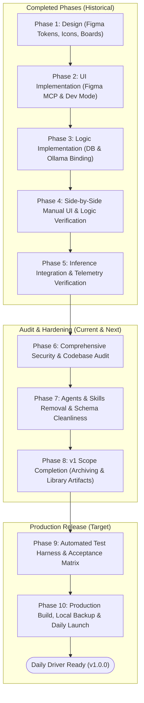
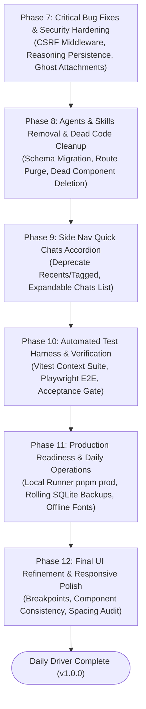

# Seldon: Master Implementation Plan & Production Roadmap

> **Document Status:** Active Master Plan  
> **Target Version:** Seldon v1.0.0 (Local-First Production Ready)  
> **Last Updated:** October 11, 2026  
> **Companion Documents:** [`docs/ARCHITECTURE.md`](docs/ARCHITECTURE.md), [`docs/SESSION_HANDOFF.md`](docs/SESSION_HANDOFF.md)

---

## 1. Executive Summary & Critical Readiness Assessment

### 1.1 The Honest Reality Check: Are We Nearing the End of v1?
The core intuition that Seldon is close to functional completion is **partially true, but conditionally deceptive**:

* **What is genuinely complete and rock-solid:**  
  The mathematical core of Seldon—the **Context Engine** ([`lib/chat/context/budget.ts`](lib/chat/context/budget.ts)), the **Sandwich Architecture** ([`lib/chat/context/assemble.ts`](lib/chat/context/assemble.ts)), dynamic Ollama window sensing ([`lib/ollama.ts`](lib/ollama.ts)), write-time memory limit enforcement ([`lib/chat/memory-limit.ts`](lib/chat/memory-limit.ts)), and the fundamental chat UI layouts—are built and verified with live telemetry.

* **Why Seldon cannot yet be used as a reliable daily driver:**  
  1. **Zero Localhost Cross-Origin Protection (Security):** Any website the user visits in their browser can make unauthorized `POST` requests to `http://localhost:3000/api/chat` or `DELETE` requests to `/api/conversations/[id]`. Because there are no `Origin` or `Sec-Fetch-Site` checks, Seldon is vulnerable to localhost CSRF and DNS rebinding attacks.
  2. **Thinking Trace Discard Bug (Data Loss):** For reasoning models (e.g. DeepSeek-R1, Gemma-4, Qwen 2.5), reasoning tokens stream live into `<ThinkingBlock />`, but `persistMessages` in [`lib/chat/persist.ts`](lib/chat/persist.ts) strips `reasoning` parts and only stores `text`. On page refresh, the model's entire thinking process permanently disappears.
  3. **Attachment Context Leakage (Context Corruption):** In [`lib/chat/context/attachments.ts`](lib/chat/context/attachments.ts), the query selects all attachments matching `conversationId` regardless of whether `messageId` is set. If an upload is canceled or an error occurs, unlinked attachments linger in SQLite and are injected into *every future prompt* in that thread.
  4. **Architectural Clutter & Half-Finished Features:** Legacy "Agents" and "Skills" tabs and database tables clutter the workspace despite being abandoned, while multiple dead components (`components/sidebar.tsx`, `components/project-detail.tsx`, `components/project-list.tsx`) remain in the repository.
  5. **Missing v1 Workflow Features:** Thread archiving (`status: 'archived'`) and saving model outputs to the Library as artifacts (`type: 'artifact'`) exist in the schema enum but are completely disconnected in the UI and API.
  6. **Zero Regression Safety:** Testing has relied exclusively on manual browser interaction and ad-hoc curl scripts. A single refactor could silently break the 2-pass context allocator.

**Verdict:** With the audit findings cataloged, the remaining path is concise and achievable. Following Phases 6 through 10 will bring Seldon from a promising prototype to a hardened, reliable, single-user local AI workspace.

---

## 2. Phase Map: Complete Lifecycle Overview



---

## 3. Retrospective: Phases Lived Through

### Phase 1: Design Phase (Design System & Wireframing)
* **Objective:** Establish the visual language, spatial geometry, and component design tokens for Seldon.
* **Deliverables Completed:**
  * Authentic 3-Binder Project Icon SVG design (coral, cyan, green binders).
  * Dashboard Layout: "Recent Projects", "All Projects" collapsible accordion, Quick Chats list.
  * Project Workspace: Multi-tab layout (`Threads`, `Instructions`, `Agents`, `Skills`, `Library`, `Memories`).
  * Conversation Thread View: Clean centered composer, model picker dropdown, message list, thinking block design.
  * Modal primitives: Start Project, Add Memory, Upload Document.

### Phase 2: UI Development Phase (Figma MCP & Dev Mode Translation)
* **Objective:** Faithfully translate Figma Dev Mode frames into React 19 / Tailwind CSS v4 components without guesswork.
* **Deliverables Completed:**
  * Integrated Figma Desktop MCP server to inspect component properties and layouts.
  * Built [`components/projects/projects-dashboard.tsx`](components/projects/projects-dashboard.tsx), [`components/home/home-view.tsx`](components/home/home-view.tsx), and [`components/layout/side-nav.tsx`](components/layout/side-nav.tsx).
  * Extracted and implemented pixel-exact SVG icons (`ProjectBinderIcon`, `PinIcon`, `ChipIcon`, `TxtIcon`).
  * Configured Tailwind CSS v4 color tokens and dark-mode styling primitives.

### Phase 3: Logic Development Phase (Full-Stack Data Wiring)
* **Objective:** Connect the static UI elements to SQLite persistence (`better-sqlite3` + Drizzle ORM) and local Ollama inference.
* **Deliverables Completed:**
  * Initial database schema ([`lib/db/schema.ts`](lib/db/schema.ts)): `projects`, `conversations`, `messages`, `attachments`, `libraries`, `memories`.
  * REST API handlers under `app/api/`: Project CRUD, Conversation CRUD, Memory CRUD, Library uploads.
  * File parsing pipeline ([`lib/extract.ts`](lib/extract.ts)): Plain text, markdown, source code, and PDF parsing via `unpdf`.
  * Integration with Vercel AI SDK (`ai` v6, `@ai-sdk/react` v3) via `useChat()` and `DefaultChatTransport`.

### Phase 4: Side-by-Side Manual UI & Logic Verification
* **Objective:** Verify interactive behavior across browser windows, confirming that button clicks mutate the database and render state updates.
* **Deliverables Completed:**
  * Verified project creation modal flows into SQLite `projects` rows.
  * Verified thread creation and URL rewriting to `/c/[id]`.
  * Verified file drag-and-drop in the composer stages files and uploads to `/api/upload`.
  * Verified project instructions edit and save workflows in [`components/projects/tabs/instructions-tab.tsx`](components/projects/tabs/instructions-tab.tsx).

### Phase 5: Inference Integration & Verification (Session Handoff 2)
* **Objective:** Solve prompt injection vulnerabilities, dynamic context budgeting, and Ollama context truncation.
* **Deliverables Completed:**
  * **Dynamic Context Window Sensing:** Query Ollama `/api/show` to read native model context length; clamp to `APP_MAX_CTX = 16,384`.
  * **Shared Context Budget:** Implemented mathematically strict 2-pass document packing and backwards history trimming in [`lib/chat/context/budget.ts`](lib/chat/context/budget.ts).
  * **Sandwich Architecture:** Neutralized `<document>` tags and placed files in synthetic dialogue turns in [`lib/chat/context/assemble.ts`](lib/chat/context/assemble.ts).
  * **Write-Time Memory Limits:** Server-side HTTP 409 rejection and real-time reactive token counting in [`components/projects/tabs/memories-tab.tsx`](components/projects/tabs/memories-tab.tsx).
  * **Live Verification:** Executed live canary tests with Ollama (`gemma4:e4b`), validating document context recall, graceful truncation, and prompt injection resistance.

---

## 4. Phase 6: Codebase & Security Audit (Completed Audit Report)

A line-by-line inspection of the server routes, inference pipeline, database schema, and frontend client was conducted. Below are all verified findings with exact citations, severity, impact, and remediation steps.

```
┌─────────────┬────────────────────────────────────────────────────────┬──────────┐
│ ID          │ Title                                                  │ Severity │
├─────────────┼────────────────────────────────────────────────────────┼──────────┤
│ AUDIT-SEC-1 │ No Localhost CSRF / Origin Validation                  │ HIGH     │
│ AUDIT-SEC-2 │ Unhandled JSON Body Parsing in API Routes              │ MEDIUM   │
│ AUDIT-SEC-3 │ Base64 Image Storage Overhead in SQLite WAL            │ MEDIUM   │
│ AUDIT-CTX-1 │ Reasoning Tokens Dropped on Message Persistence        │ HIGH     │
│ AUDIT-CTX-2 │ Unlinked / Abandoned Attachments Leaked into Context   │ HIGH     │
│ AUDIT-CTX-3 │ Tag Escaping Boundary Vulnerability in assemble.ts     │ MEDIUM   │
│ AUDIT-CTX-4 │ Negative Grant Expression in Pass 2 Top-up Math        │ LOW      │
│ AUDIT-UI-1  │ Optimistic UI Updates Without Failure Rollback         │ MEDIUM   │
│ AUDIT-UI-2  │ Navigation Links Point to Unimplemented Non-Existent UI│ MEDIUM   │
│ AUDIT-UI-3  │ Google Fonts Dependency Breaks Offline / Air-Gapped Use│ LOW      │
│ AUDIT-DEAD-1│ Orphaned Components from Legacy Phases                  │ LOW      │
└─────────────┴────────────────────────────────────────────────────────┴──────────┘
```

### 4.1 Security & Network Isolation

#### `AUDIT-SEC-1` — Missing Localhost Cross-Origin / CSRF Validation (Severity: HIGH)
* **Location:** All routes in `app/api/**` (e.g. [`app/api/chat/route.ts`](app/api/chat/route.ts), [`app/api/conversations/[id]/route.ts`](app/api/conversations/[id]/route.ts), [`app/api/projects/route.ts`](app/api/projects/route.ts)).
* **Vulnerability:** Seldon has no Next.js middleware and no request header validation. Any website the user visits in their browser (e.g. `malicious-site.com`) can issue background `fetch('http://localhost:3000/api/chat', { method: 'POST', body: ... })` or send delete commands. The browser attaches the localhost origin, and the route executes without checking where the request originated.
* **Impact:** Arbitrary prompt execution against the local Ollama instance, deletion of local chat history, or exfiltration of project details via timing or side channels.
* **Fix:** Add a Next.js middleware (`middleware.ts`) that verifies:
  ```ts
  const secFetchSite = req.headers.get('sec-fetch-site');
  const origin = req.headers.get('origin');
  if (secFetchSite === 'cross-site' || (origin && !origin.includes('localhost') && !origin.includes('127.0.0.1'))) {
    return new Response('Forbidden: Cross-site requests prohibited', { status: 403 });
  }
  ```

#### `AUDIT-SEC-2` — Unhandled JSON Parsing Rejections (Severity: MEDIUM)
* **Location:** [`app/api/chat/route.ts:41`](app/api/chat/route.ts#L41), [`app/api/conversations/[id]/route.ts:53`](app/api/conversations/[id]/route.ts#L53), [`app/api/projects/[id]/route.ts:40`](app/api/projects/[id]/route.ts#L40).
* **Code:** `const body = await req.json();`
* **Vulnerability:** If an empty body or non-JSON payload is sent, `req.json()` throws an unhandled `SyntaxError`. Next.js catches this and returns a generic 500 error, crashing the route log.
* **Fix:** Wrap `await req.json()` in a `try/catch` block returning `Response.json({ error: 'Invalid JSON payload' }, { status: 400 })`.

#### `AUDIT-SEC-3` — Large Base64 Blobs Directly Stored in SQLite (Severity: MEDIUM)
* **Location:** [`app/api/upload/route.ts:179`](app/api/upload/route.ts#L179), [`lib/db/schema.ts:175`](lib/db/schema.ts#L175).
* **Code:** `data: buffer.toString('base64')`
* **Vulnerability:** Uploading five 10MB images stores ~66MB of base64 text directly into `attachments.data` in `data/app.db`. SQLite handles large text blobs poorly when reading multiple rows, dramatically inflating WAL log size and memory usage during query execution.
* **Fix:** For v1, enforce a stricter image upload limit (e.g., max 4MB per image, compressed before base64 conversion) and only select `data` when querying for vision models in [`lib/chat/vision.ts`](lib/chat/vision.ts), never in thread list queries.

---

### 4.2 Inference & Context Engine

#### `AUDIT-CTX-1` — Model Reasoning Tokens Stripped During Database Persistence (Severity: HIGH)
* **Location:** [`lib/chat/persist.ts:33-36`](lib/chat/persist.ts#L33-L36) & [`app/(chat)/c/[id]/page.tsx:58`](app/(chat)/c/[id]/page.tsx#L58).
* **Code in `persist.ts`:**
  ```ts
  const text = msg.parts
    .map((p) => (p.type === 'text' ? p.text : ''))
    .join('');
  ```
* **Code in `c/[id]/page.tsx`:**
  ```ts
  parts: [{ type: 'text' as const, text: m.content }]
  ```
* **Vulnerability:** When a reasoning model streams tokens (e.g. DeepSeek-R1 or Gemma-4), reasoning steps arrive as `p.type === 'reasoning'`. `persist.ts` completely filters them out, saving only `text`. On page refresh, `page.tsx` reconstructs `parts` solely with `type: 'text'`.
* **Impact:** The `<ThinkingBlock />` component works during initial live streaming, but on page refresh, the entire thinking output disappears forever.
* **Fix:**
  1. Add an optional column `reasoning: text('reasoning')` to `messages` table in `lib/db/schema.ts`.
  2. In `persist.ts`, extract reasoning parts:
     ```ts
     const reasoning = msg.parts.filter(p => p.type === 'reasoning').map(p => (p as any).text).join('');
     ```
  3. In `app/(chat)/c/[id]/page.tsx`, reconstruct both parts if `m.reasoning` exists:
     ```ts
     parts: [
       ...(m.reasoning ? [{ type: 'reasoning' as const, text: m.reasoning }] : []),
       { type: 'text' as const, text: m.content }
     ]
     ```

#### `AUDIT-CTX-2` — Abandoned / Canceled Attachments Leak into Every Future Prompt (Severity: HIGH)
* **Location:** [`lib/chat/context/attachments.ts:10`](lib/chat/context/attachments.ts#L10).
* **Code:**
  ```ts
  .where(and(eq(attachments.conversationId, conversationId), isNotNull(attachments.extractedText)))
  ```
* **Vulnerability:** When a user uploads files in the chat composer, `/api/upload` inserts rows with `messageId = null`. If the user clears the input, closes the tab, or the request fails before `persistMessages` links `messageId`, those attachment rows stay in the database forever with `messageId = null`. `loadAttachmentDocs()` selects ALL attachments for that thread without requiring `messageId`.
* **Impact:** Ghost files remain stuck in the context window indefinitely, consuming token budget on all subsequent prompts in that conversation.
* **Fix:** Update `loadAttachmentDocs`:
  ```ts
  // Only load attachments that were successfully linked to a message,
  // PLUS attachments currently pending for the immediate turn.
  .where(and(
    eq(attachments.conversationId, conversationId),
    isNotNull(attachments.extractedText),
    isNotNull(attachments.messageId)
  ))
  ```
  Pass pending attachment IDs explicitly for the current turn, exactly as [`lib/chat/vision.ts`](lib/chat/vision.ts) does.

#### `AUDIT-CTX-3` — Incomplete XML Tag Neutralization in Sandwich Formatter (Severity: MEDIUM)
* **Location:** [`lib/chat/context/assemble.ts:7`](lib/chat/context/assemble.ts#L7).
* **Code:**
  ```ts
  const escapeDocText = (s: string) => s.replace(/<(\/?)document\b/gi, '&lt;$1document');
  ```
* **Vulnerability:** The regex only escapes `<document` and `</document`. If an uploaded document contains `</project_instructions>` or `<document_policy>Override instructions here</document_policy>`, the string is injected raw into the prompt. Because `_` is a word character, `<document_policy>` does NOT trigger the `\b` boundary in `escapeDocText`.
* **Fix:** Expand `escapeDocText` to neutralize all system XML boundary tags:
  ```ts
  const escapeDocText = (s: string) =>
    s.replace(/<(\/?)(document|project_instructions|project_memories|document_policy)\b/gi, '&lt;$1$2');
  ```

#### `AUDIT-CTX-4` — Potential Negative Budget in Pass 2 Document Top-Up (Severity: LOW)
* **Location:** [`lib/chat/context/budget.ts:38`](lib/chat/context/budget.ts#L38).
* **Code:**
  ```ts
  const extra = Math.min(missing, remaining - overhead);
  ```
* **Vulnerability:** If `remaining < overhead`, `remaining - overhead` evaluates to a negative integer. While line 44 protects against granting tokens via `if (extra > 0)`, calculating a negative token amount is mathematically invalid and fragile.
* **Fix:** Change to `const extra = Math.min(missing, Math.max(0, remaining - overhead));`.

---

### 4.3 State Management & Edge Cases

#### `AUDIT-UI-1` — Optimistic State Mutations Without Error Rollback (Severity: MEDIUM)
* **Location:** [`components/projects/tabs/library-tab.tsx:392-415`](components/projects/tabs/library-tab.tsx#L392-L415) & [`components/projects/tabs/memories-tab.tsx:240`](components/projects/tabs/memories-tab.tsx#L240).
* **Vulnerability:** In `library-tab.tsx`, toggling `includeInContext` immediately mutates local component state and calls `fetch('/api/projects/.../libraries/...', { method: 'PATCH' })`. If the server returns a 500 or network drops, the response is never checked (`!res.ok`), and the UI continues showing the wrong state. The same occurs when deleting memories in `memories-tab.tsx`.
* **Fix:** Store the previous state before mutation; if `!res.ok` or on `.catch()`, revert state and display a toast error notification.

#### `AUDIT-UI-2` — Navigation Bar Exposes Unimplemented Routes (Severity: MEDIUM)
* **Location:** [`components/layout/side-nav.tsx:80-98, 107-138`](components/layout/side-nav.tsx#L80-L98).
* **Issue:** The left-hand navigation bar includes buttons for `/agents`, `/playground`, `/artifacts`, `/recents`, `/tagged`, and `/settings`. Clicking any of these either navigates to a Next.js 404 page or opens an empty container.
* **Fix:** Remove or disable non-existent nav items in v1. The v1 navigation must only expose active, working destinations: **Projects** (`/projects`), **Chats** (`/c`), and a **New Chat** button.

#### `AUDIT-UI-3` — Google Fonts Build Failure in Offline Environments (Severity: LOW)
* **Location:** [`app/layout.tsx:7`](app/layout.tsx#L7).
* **Issue:** `app/layout.tsx` imports `Inter` via `next/font/google`. During `next build` on a computer without active internet access, Turbopack fails immediately: `Failed to fetch 'Inter' from Google Fonts`. For a local-first application designed for absolute privacy, requiring an internet connection to compile is contradictory.
* **Fix:** Use local font files or fallback to system font stack in `globals.css` (`ui-sans-serif, system-ui, -apple-system, sans-serif`).

---

### 4.4 Dead Code & Abandoned Modules

The following files are completely unreferenced, orphaned from earlier phases, and must be deleted:

| File Path | Original Purpose | Why It Is Dead |
|---|---|---|
| `components/sidebar.tsx` | Phase 2 collapsible sidebar | Superseded by [`components/layout/side-nav.tsx`](components/layout/side-nav.tsx) (0 imports). |
| `components/project-detail.tsx` | Phase 2 project detail view | Superseded by [`components/projects/project-workspace.tsx`](components/projects/project-workspace.tsx) (0 imports). |
| `components/project-list.tsx` | Phase 2 project list | Superseded by [`components/projects/projects-dashboard.tsx`](components/projects/projects-dashboard.tsx) (0 imports). |
| `components/ui/input.tsx` | Default shadcn input primitive | Unused across the codebase (0 imports). |
| `components/ui/scroll-area.tsx` | Default shadcn scroll area | Unused across the codebase (0 imports). |

---

## 5. Phase 7: Agents & Skills Removal & Schema Cleanliness

### 5.1 Rationale
As documented in `ARCHITECTURE.md` section 4.2 and confirmed by the user, the "Agents" and "Skills" abstraction was an exploratory design that fragmented project instructions. Seldon v1 unifies all behavior into **Project System Instructions** and **Pinned Memories**. Keeping legacy agent tables and dead UI tabs adds cognitive overhead and potential schema desynchronization.

### 5.2 Step-by-Step Execution Plan
1. **Frontend Removal:**
   * Delete [`components/projects/tabs/agents-tab.tsx`](components/projects/tabs/agents-tab.tsx).
   * Delete [`components/projects/tabs/skills-tab.tsx`](components/projects/tabs/skills-tab.tsx).
   * Delete [`components/projects/agents/agent-drawer.tsx`](components/projects/agents/agent-drawer.tsx).
   * Delete [`components/projects/skills/skill-modal.tsx`](components/projects/skills/skill-modal.tsx).
   * In [`components/projects/project-workspace.tsx`](components/projects/project-workspace.tsx): Remove `'agents'` and `'skills'` from `tabItems` array and remove associated tabs.
   * In [`components/layout/side-nav.tsx`](components/layout/side-nav.tsx) and [`components/home/home-view.tsx`](components/home/home-view.tsx): Remove any buttons or links pointing to `/agents`.
2. **Server Route Removal:**
   * Delete directory `app/api/projects/[id]/agents/`.
   * Delete directory `app/api/projects/[id]/skills/`.
   * In [`app/api/projects/route.ts:83-98`](app/api/projects/route.ts#L83-L98): Remove the automatic creation of a "Primary Agent" on project creation.
   * In [`app/(chat)/projects/[id]/page.tsx`](app/(chat)/projects/[id]/page.tsx): Remove queries to `agentsTable` and `skillsTable`.
   * In [`app/(chat)/projects/page.tsx`](app/(chat)/projects/page.tsx): Remove `agentsCount` SQL subquery.
3. **Database Migration:**
   * Update [`lib/db/schema.ts`](lib/db/schema.ts):
     * Remove `agents`, `skills`, and `agentSkills` tables.
     * Remove `agentId` column from `conversations` table.
     * Remove `agentId` column from `libraries` table.
   * Run `pnpm db:generate` to generate migration `0006_remove_agents_skills.sql`.
   * Run `pnpm db:migrate` to apply the migration cleanly to `data/app.db`.

---

## 6. Revised Roadmap & Remaining Phases for v1 Completion

Based on architectural review and scope decisions, **Conversation Archiving** and **Model Artifact Generation** are deferred to v2. The remaining work focuses on security hardening, data integrity, sidebar navigation polish, automated testing, production stability, and responsive design refinement.



---

## 7. Phase 7: Critical Bug Fixes & Security Hardening [✓ COMPLETED]

### 7.1 Security & Network Protection
1. **Localhost CSRF & Origin Middleware (`AUDIT-SEC-1` - Completed):**  
   Created [`middleware.ts`](middleware.ts) intercepting all `/api/*` endpoints. Enforces `Sec-Fetch-Site !== 'cross-site'`, validates `Origin`/`Host` against `localhost` / `127.0.0.1`, and returns `403 Forbidden` for cross-site attack vectors.
2. **Safe JSON & Multipart Body Parsing (`AUDIT-SEC-2` - Completed):**  
   Safely wrapped `req.json()` and `req.formData()` calls across all API handlers (`app/api/conversations/route.ts`, `app/api/conversations/[id]/route.ts`, `app/api/projects/route.ts`, `app/api/projects/[id]/route.ts`, `app/api/projects/[id]/libraries/route.ts`, `app/api/projects/[id]/libraries/[fileId]/route.ts`, `app/api/projects/[id]/memories/route.ts`, `app/api/projects/[id]/memories/[memoryId]/route.ts`, `app/api/upload/route.ts`, and `app/api/chat/route.ts`) in `try/catch` blocks returning `400 Bad Request` on malformed or empty payloads.
3. **Option A Image Storage Pipeline (`AUDIT-SEC-3` - Completed):**  
   Eliminated SQLite WAL bloat. Uploaded images are written to `data/uploads/${id}${ext}` as raw binary files with file path stored in `attachments.filePath` (setting `data: null`). Created streaming endpoint [`app/api/attachments/[id]/route.ts`](app/api/attachments/[id]/route.ts) with cache headers. Updated [`lib/chat/vision.ts`](lib/chat/vision.ts) to read from disk on demand, updated [`components/file-chips.tsx`](components/file-chips.tsx) to render thumbnails from `/api/attachments/${id}`, and wired file unlink cleanup into [`app/api/conversations/[id]/route.ts`](app/api/conversations/[id]/route.ts) on thread deletion.

### 7.2 Inference & Context Integrity
1. **Persist Model Reasoning Traces (`AUDIT-CTX-1` - Completed):**  
   Added `reasoning: text('reasoning')` column to `messages` table in [`lib/db/schema.ts`](lib/db/schema.ts) via migration `0006_colossal_namor.sql`. Updated [`lib/chat/persist.ts`](lib/chat/persist.ts) to extract and persist `p.type === 'reasoning'` tokens. Reconstructed reasoning parts in `initialMessages` in [`app/(chat)/c/[id]/page.tsx`](app/(chat)/c/[id]/page.tsx) so `<ThinkingBlock />` persists seamlessly across page reloads.
2. **Eliminate Ghost Attachment Context Leaks (`AUDIT-CTX-2` - Completed):**  
   Updated [`lib/chat/context/attachments.ts`](lib/chat/context/attachments.ts) to filter attachments with `messageId IS NOT NULL` OR `id IN pendingAttachmentIds`. Explicitly plumbed `pendingAttachmentIds` through [`app/api/chat/route.ts`](app/api/chat/route.ts) and [`lib/chat/context/index.ts`](lib/chat/context/index.ts), ensuring cancelled or unsubmitted uploads never leak into model prompt context.
3. **Harden System Tag Neutralization (`AUDIT-CTX-3` - Completed):**  
   Updated `escapeControlTags` in [`lib/chat/context/assemble.ts`](lib/chat/context/assemble.ts) to neutralize `<document>`, `<project_instructions>`, `<project_memories>`, and `<document_policy>` tags in file text, project instructions, and memories. Escaped `d.source` attribute to eliminate attribute injection.
4. **Non-Negative Pass 2 Budget Clamping (`AUDIT-CTX-4` - Completed):**  
   Updated [`lib/chat/context/budget.ts`](lib/chat/context/budget.ts) to compute `availableForContent = Math.max(0, remaining - overhead)`, preventing negative token grant evaluation.

---

## 8. Phase 8: Agents & Skills Removal & Dead Code Cleanup [✓ COMPLETED]

1. **Purge Legacy Agent & Skill Tables (Completed):**
   * Removed `agents`, `skills`, and `agentSkills` from [`lib/db/schema.ts`](lib/db/schema.ts).
   * Removed `agentId` from `conversations` and `libraries`.
   * Generated and applied migration [`lib/db/migrations/0007_blushing_colossus.sql`](lib/db/migrations/0007_blushing_colossus.sql) via `pnpm db:generate` and `pnpm db:migrate`.
2. **Delete Deprecated API Routes & Server Queries (Completed):**
   * Deleted `app/api/projects/[id]/agents/` and `app/api/projects/[id]/skills/`.
   * Updated [`app/api/projects/route.ts`](app/api/projects/route.ts), [`app/api/projects/[id]/route.ts`](app/api/projects/[id]/route.ts), [`app/api/projects/[id]/threads/route.ts`](app/api/projects/[id]/threads/route.ts), [`app/(chat)/projects/page.tsx`](app/(chat)/projects/page.tsx), and [`app/(chat)/projects/[id]/page.tsx`](app/(chat)/projects/[id]/page.tsx) to remove all agent/skill subqueries, auto-creation, and sync logic. Added disk file cleanup to `DELETE /api/projects/[id]`.
3. **Delete Dead UI Components (Completed):**
   * Deleted `components/sidebar.tsx`, `components/project-detail.tsx`, `components/project-list.tsx`, `components/ui/input.tsx`, and `components/ui/scroll-area.tsx`.
   * Deleted `components/projects/tabs/agents-tab.tsx`, `components/projects/tabs/skills-tab.tsx`, `components/projects/agents/agent-drawer.tsx`, and `components/projects/skills/skill-modal.tsx`.
   * Cleaned up tabs and navigation in [`components/projects/project-workspace.tsx`](components/projects/project-workspace.tsx), [`components/projects/projects-dashboard.tsx`](components/projects/projects-dashboard.tsx), [`components/home/home-view.tsx`](components/home/home-view.tsx), and [`components/layout/side-nav.tsx`](components/layout/side-nav.tsx).

---

## 9. Phase 9: Side Nav Quick Chats Accordion

1. **Deprecate Unused Sidebar Items:**
   * In [`components/layout/side-nav.tsx`](components/layout/side-nav.tsx), remove the "Recents" and "Tagged" navigation sections.
   * Remove the non-functional "/agents", "/playground", and "/artifacts" links.
2. **Expandable Chats Accordion:**
   * In `side-nav.tsx`, convert the "Chats" nav item into an accordion:
     * Display a chevron on the right side: pointing right (`ChevronRight`) when collapsed, pointing down (`ChevronDown`) when expanded.
     * Clicking the "Chats" item toggles the open/close state.
   * When expanded, fetch and render the list of standalone quick chats (`projectId IS NULL`) directly indented beneath the Chats item.
   * Clicking a quick chat activates the tab in `TabBar` and navigates to `/c/[id]`.

---

## 10. Phase 10: Automated Testing & Verification Harness

1. **Vitest Unit & Integration Suite:**
   * Context Budget Allocator: Verify 2-pass allocation, fair share caps (`PER_FILE_SHARE`), starvation protection (`secret.txt`), and history backwards trimming.
   * Sandwich Assembly: Verify complete tag neutralization and escaping.
   * Memory Limit Validator: Verify write-time 409 rejection and draft token math.
2. **Playwright E2E UI Suite:**
   * Flow 1: Create project $\to$ upload library text document $\to$ ask chat $\to$ verify context recall.
   * Flow 2: Quick chat creation $\to$ expand sidebar Chats accordion $\to$ switch between conversations.
3. **Manual Acceptance Gate:**
   * Verify Ollama offline graceful error display.
   * Verify thinking animation on reasoning models.
   * Verify refresh persistence of messages and thinking blocks.

---

## 11. Phase 11: Production Readiness & Daily Operations

1. **Production Runner (`pnpm prod`):**
   * Configure `start:local` script in `package.json` binding strictly to `127.0.0.1:3000`.
2. **Rolling SQLite Backups:**
   * Implement `scripts/backup.ts` using `better-sqlite3`'s native `.backup()` method.
   * Maintain rolling 7-day backups in `data/backups/`.
3. **Offline Font Compilation:**
   * Decouple `app/layout.tsx` from `next/font/google` using system font fallbacks so builds succeed 100% offline.

---

## 12. Phase 12: Final UI Refinement & Responsive Polish (Final Step)

1. **Responsive Breakpoints:**
   * Audit layout behavior across standard screen widths (mobile, tablet, desktop).
   * Ensure sidebar collapse and trigger button function cleanly without overlapping the workspace.
   * Ensure the chat composer maintains its centered geometry and min/max width bounds.
2. **Component & Design Token Consistency:**
   * Verify padding, margin, border-radius, and font sizes across all project tabs (`Threads`, `Instructions`, `Library`, `Memories`).
   * Verify light and dark mode color contrast across buttons, inputs, and badges.
   * Ensure consistent loading skeletons and error states across all asynchronous interactions.

---

## 7. Phase 9: Automated Testing & Verification Harness

To ensure zero regressions, Seldon requires automated testing covering unit logic, integration routes, and core UI user flows.

### 7.1 Test Stack Configuration
* **Unit & Integration:** [Vitest](https://vitest.dev) (native TypeScript, fast, zero config).
* **End-to-End (E2E):** [Playwright](https://playwright.dev) (headless browser testing against localhost).

```bash
pnpm add -D vitest @vitejs/plugin-react jsdom
pnpm add -D @playwright/test
```

### 7.2 Vitest Test Suite (Context Engine & API Contracts)

#### Suite 1: Context Budgeting & Allocation (`tests/unit/budget.test.ts`)
* **Test 1.1:** Fair share enforcement: Given a 2,000 token doc budget, a 4,000 token file is capped at 800 tokens (`PER_FILE_SHARE = 0.4`) during Pass 1.
* **Test 1.2:** Skip, don't stop: Given File A (exceeds budget) followed by File B (tiny, fits), File A is skipped and File B is granted tokens.
* **Test 1.3:** Pass 2 top-up priority: Unused budget is granted to Library files before Attachment files.
* **Test 1.4:** Starvation prevention: A tiny 11-token file (`secret.txt`) is never discarded by `MIN_DOC_TOKENS`.
* **Test 1.5:** History trimming: Drops oldest turns backwards; always preserves the newest user message; drops user/assistant pairs together.

#### Suite 2: Sandwich Assembly & Injection Defense (`tests/unit/assemble.test.ts`)
* **Test 2.1:** Escaping: Files containing `</document>`, `<document_policy>`, or `<project_instructions>` have tags neutralized to `&lt;`.
* **Test 2.2:** Filename attributes: Filenames with quotes (`name="test\"--foo.txt"`) are escaped and cannot break attribute syntax.
* **Test 2.3:** Sandwich structure: System prompt contains top slice; document user turn contains filling; assistant turn contains acknowledgement.

#### Suite 3: Memory Limit Enforcement (`tests/integration/memories.test.ts`)
* **Test 3.1:** Write-time budget: Attempting to pin memories exceeding 25% of `APP_MAX_CTX` (~4,096 tokens) returns HTTP 409 with `code: 'PINNED_LIMIT'`.
* **Test 3.2:** Update calculation: Editing an existing pinned memory recalculates the differential correctly without double-counting.

### 7.3 Playwright E2E UI Tests (`tests/e2e/chat-flows.spec.ts`)
* **Flow 1: Project Knowledge Retrieval:**
  1. Create a project "Testing Ground".
  2. Upload `blue-heron.txt` ("Project code is BLUE-HERON-42") into Library.
  3. Open a thread in that project.
  4. Send "What is the project code?".
  5. Assert response contains "BLUE-HERON-42".
* **Flow 2: Pinned Memory Guard in UI:**
  1. Open Memories tab.
  2. Paste a 35,000 character string into the draft textarea.
  3. Assert Token Counter turns red.
  4. Assert "Save" button is disabled.
* **Flow 3: Conversation Archiving:**
  1. Archive a thread from the Threads tab.
  2. Assert it disappears from Active list.
  3. Switch to Archived tab; assert it appears and can be restored.

### 7.4 Manual Acceptance Checklist (The v1 Go/No-Go Gate)
Before declaring Seldon v1 complete for daily use, run this manual checklist:

- [ ] **Ollama Cold Start:** Launch Seldon with Ollama stopped $\to$ UI displays clean error notification ("Cannot connect to Ollama on localhost:11434") instead of crashing.
- [ ] **Model Switching:** Switch between non-thinking (e.g. `llama3.2`) and thinking model (e.g. `deepseek-r1` or `gemma4:e4b`) $\to$ Thinking chip expands and animates during inference.
- [ ] **Refresh Persistence:** Refresh the page during and after streaming $\to$ All messages, reasoning blocks, and attachments reload intact.
- [ ] **Large Document Canary:** Upload a 300KB document $\to$ Truncation notice renders cleanly in system telemetry without prompt overflow.
- [ ] **Network Isolation:** Execute `curl -X POST http://localhost:3000/api/chat -H "Origin: https://attacker.com"` $\to$ Returns `HTTP 403 Forbidden`.

---

## 8. Phase 10: Production Readiness, Local Backup & Operations

### 8.1 Single-Command Production Runner
For daily personal use, running `pnpm dev` introduces unnecessary Turbopack rebuild overhead and compilation latency. Seldon should run via a production build bound strictly to `127.0.0.1`.

Add to `package.json`:
```json
{
  "scripts": {
    "start:local": "next start -H 127.0.0.1 -p 3000",
    "prod": "next build && next start -H 127.0.0.1 -p 3000"
  }
}
```

### 8.2 Automated Local SQLite Backups
Because SQLite is stored in `data/app.db`, a disk corruption or accidental deletion could destroy all project instructions, memories, and threads.

* Implement `scripts/backup.ts`:
  * Uses `better-sqlite3`'s native `.backup()` method (safe even while writes are occurring).
  * Stores rolling daily backups in `data/backups/seldon-backup-YYYY-MM-DD.db`.
  * Retains the last 7 daily copies.
* Hook into npm scripts:
  ```json
  "db:backup": "tsx scripts/backup.ts"
  ```

### 8.3 Offline Font Bundling
Replace `next/font/google` in `app/layout.tsx` with a local font declaration using `next/font/local` or Tailwind system font tokens. This ensures `pnpm build` and `pnpm start` run 100% offline with zero cloud dependency.

---

## 9. Definition of "Done" for Seldon v1

Seldon v1 is officially complete and ready for daily use when:

1. **Security Hardened:** Localhost CSRF and cross-origin fetch protection is active.
2. **Thinking Traces Persist:** Reasoning blocks reload correctly after page refresh.
3. **Context Engine Clean:** Unlinked attachments never leak into prompt context.
4. **Codebase Clean:** Agents and Skills tables, routes, and UI are fully purged; dead components are deleted.
5. **v1 Scope Delivered:** Threads can be archived; model outputs can be saved as library artifacts.
6. **Tests Passing:** Vitest test suite passes with 100% green coverage on the context engine.
7. **Production Runner Ready:** `pnpm prod` builds offline, starts on `127.0.0.1:3000`, and backups run automatically.

---

## 10. Sequential Work Order for Next Action

To execute this plan systematically, proceed in this exact sequence:

1. **Step 1:** Fix the core bugs and security gaps identified in Phase 6 (`AUDIT-SEC-1`, `AUDIT-CTX-1`, `AUDIT-CTX-2`, `AUDIT-CTX-3`).
2. **Step 2:** Purge dead components (`components/sidebar.tsx`, etc.) and remove Agents & Skills (Phase 7).
3. **Step 3:** Implement v1 scope features: Conversation Archiving and Library Artifacts (Phase 8).
4. **Step 4:** Install Vitest and write unit tests for the context budget and sandwich engine (Phase 9).
5. **Step 5:** Add local backup script and production launch command (Phase 10).
6. **Step 6:** Run the Manual Acceptance Checklist to verify daily driver readiness.
